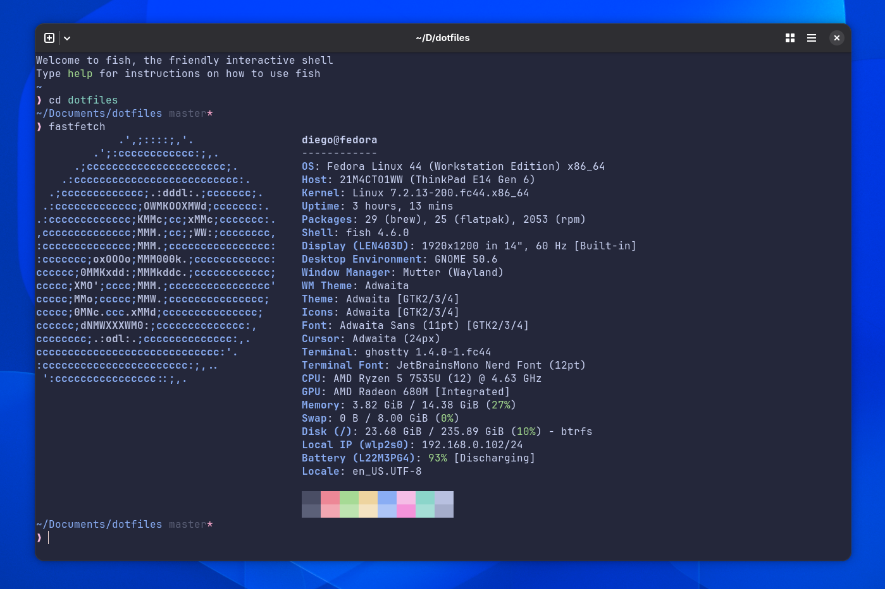

# dotfiles

My personal dotfiles, managed with [mise](https://mise.jdx.dev).

I'm following the [single-file-per-tool](https://arslan.io/2023/05/10/the-benefits-of-using-a-single-init-lua-vimrc-file) approach, where each tool has its own dedicated configuration file. This keeps everything simple, organized, and easy to maintain.

```bash
git clone git@github.com:ifdiego/dotfiles.git ~/Documents/dotfiles
bash bootstrap.sh
```

My dotfiles come with a few key features:

- Declarative system packages via mise, across DNF, Flatpak, and Homebrew
- Two-line [Starship](https://starship.rs) prompt with Pure preset
- Zoxide-powered `cd` to jump between projects directories
- Dockerfile to test the whole setup on [Fedora](https://fedoraproject.org/workstation)
- Bootstrap also clones your personal working repositories
- Fast shell startup:
````
❯ time fish_prompt
________________________________________________________
Executed in   18.37 millis    fish           external
   usr time   11.16 millis    1.47 millis    9.69 millis
   sys time   21.21 millis    0.00 millis   21.21 millis

````


